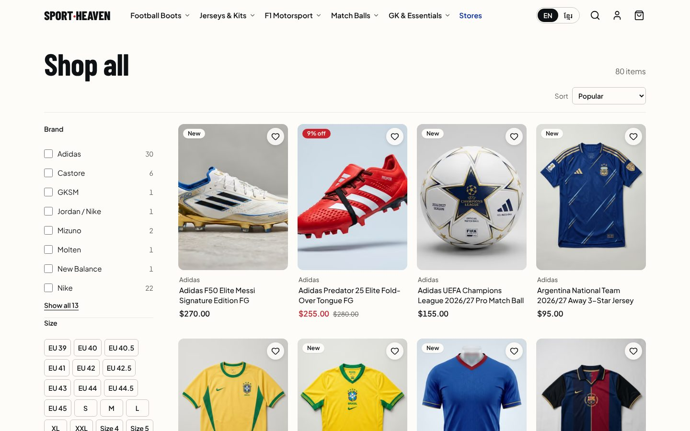
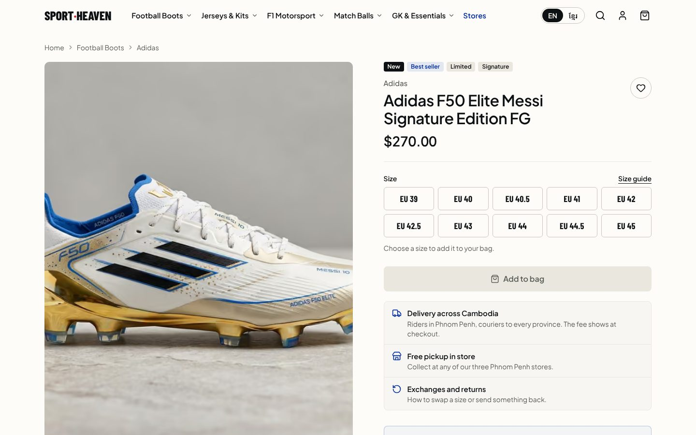
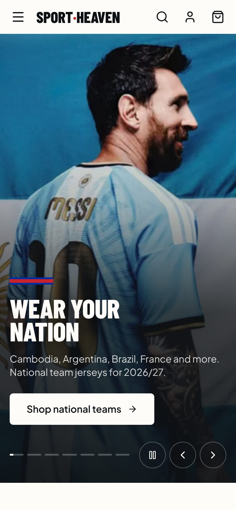
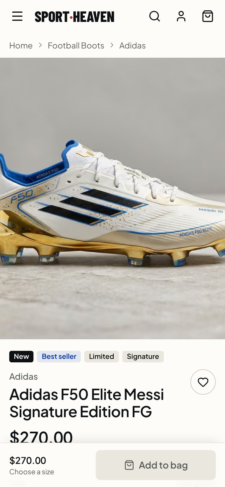
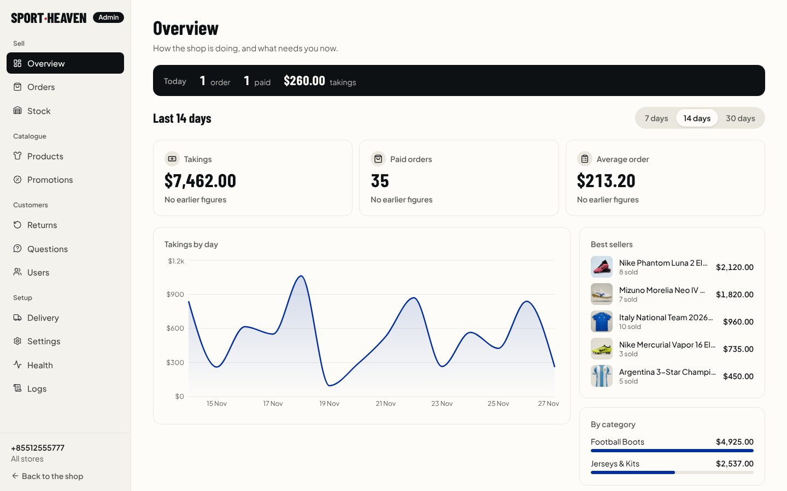
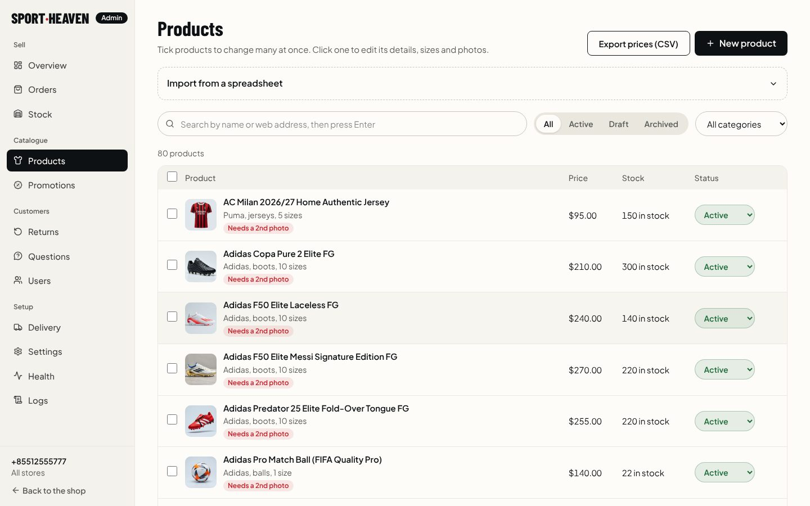

<div align="center">

# SPORT·HEAVEN

**Football boots, national-team jerseys and match gear — the online shop for Sport Heaven in Phnom Penh.**

English & ខ្មែរ · KHQR, card & cash on pickup · Delivery across Cambodia · Pickup at three stores

[](https://github.com/danishsary8/sport-heaven/actions/workflows/ci.yml)


<br/>


</div>

---

## The shop

<table>
  <tr>
    <td width="50%"></td>
    <td width="50%"></td>
  </tr>
  <tr>
    <td align="center"><b>Browse</b> — categories, brands, collections, filters and search</td>
    <td align="center"><b>Product</b> — sizes with live stock, size guide, wishlist, delivery & pickup info</td>
  </tr>
</table>

### Built for phones first

<p align="center">
  
  &nbsp;&nbsp;&nbsp;
  
</p>

## The admin

<table>
  <tr>
    <td width="50%"></td>
    <td width="50%"></td>
  </tr>
  <tr>
    <td align="center"><b>Overview</b> — today's trading, takings by day, best sellers, by category</td>
    <td align="center"><b>Products</b> — stock at a glance, status in place, bulk changes, photo manager</td>
  </tr>
</table>

Staff see their own store; admins see every store. Orders, stock, promotions, returns, questions, users, delivery zones, settings, system health and logs all live under `/admin`.

## What's inside

| | |
|---|---|
| 🛍️ **Shopping** | Categories, brands, collections, search, wishlist, custom name & number printing |
| 🌏 **Two languages** | English and Khmer throughout, with Noto Sans Khmer |
| 💳 **Payments** | Bakong KHQR (any Cambodian banking app), ABA PayWay card, cash on pickup |
| 🚚 **Fulfilment** | Riders in Phnom Penh, couriers to every province, free pickup at three stores |
| 👤 **Accounts** | Phone sign-in, addresses, order history, returns & exchanges, loyalty points |
| 📊 **Admin** | Sales charts, order workflow, stock per store, CSV price import, photo uploads |
| ♿ **Accessible** | Keyboard and screen-reader friendly, checked with axe in end-to-end tests |
| ⚡ **Fast** | Code-split per page; the build fails if first-load JavaScript goes over budget |

## Tech stack

**React 19** · **React Router** · **TanStack Query** · **Tailwind CSS 4** · **Vite** · **TypeScript** · **Zod** · **Recharts** · **Firebase Auth** · **Google Maps**

Tests: **Vitest** + Testing Library + MSW for units, **Playwright** + axe against the real backend for end-to-end.

The API lives in a separate repository, **[sport-backend](https://github.com/danishsary8/sport-backend)** (Node, Express, PostgreSQL). API types are generated from its OpenAPI contract into `src/lib/api/types.gen.ts`.

## Getting started

You need Node 22 and a running [sport-backend](https://github.com/danishsary8/sport-backend) (it listens on port 3000 by default).

```bash
npm ci
```

```bash
cp .env.example .env.local
```

```bash
npm run dev
```

The dev server proxies `/v1` to the API on `localhost:3000`, so the shop and API share one origin.

### Environment

| Variable | What it is |
|---|---|
| `VITE_API_URL` | The API's address in production (same site as the shop, so the bag cookie works) |
| `VITE_FIREBASE_*` | Firebase web keys for phone sign-in |
| `VITE_GOOGLE_MAPS_API_KEY` | Map for picking a delivery address |
| `VITE_AUTH_TEST_MODE` | Test sign-in for e2e builds only — a production build refuses to finish with it |

### Scripts

| Command | Does |
|---|---|
| `npm run dev` | Dev server with hot reload |
| `npm test` | Unit and component tests |
| `npm run e2e` | End-to-end tests (starts the backend on a fresh database) |
| `npm run typecheck` · `npm run lint` | Type and lint checks |
| `npm run build` | Production build into `dist/`, with a bundle-size check |

## Project layout

```
src/
├─ app/          routes and app shell
├─ features/     catalog · cart · checkout · payment · orders · account · admin · pages · geo
├─ lib/          API client and generated types
├─ ui/           shared components
└─ test/         MSW handlers, fixtures and helpers
e2e/             Playwright specs (guest, member, staff, accessibility)
docs/            hosting guide, screenshots, design notes
```

## Deploying

`npm run build` produces static files in `dist/` that any static host can serve. SPA fallbacks are already set up for Vercel, Netlify and Cloudflare Pages. See **[docs/HOSTING.md](docs/HOSTING.md)** for the full checklist and an nginx example, and **[GO_LIVE_NOTES.md](GO_LIVE_NOTES.md)** for going live.

<div align="center">
<br/>
<sub>Made in Phnom Penh 🇰🇭</sub>
</div>
