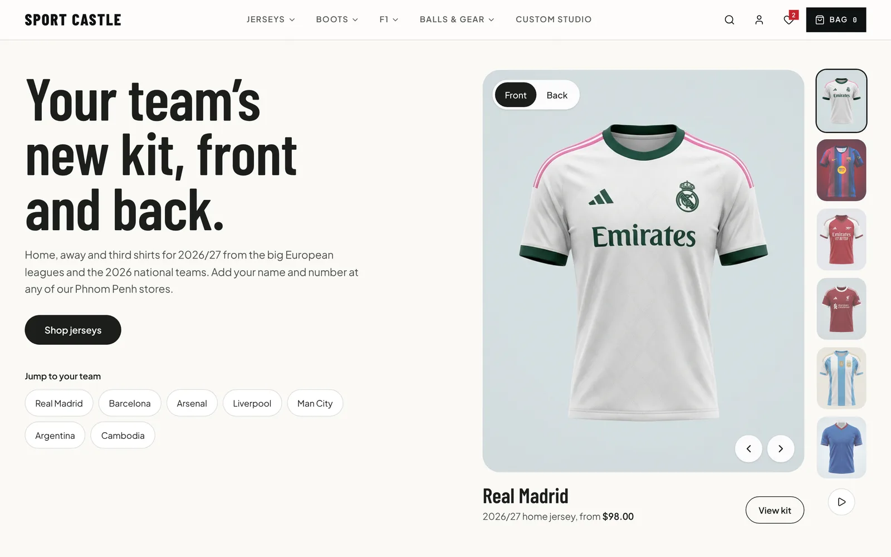
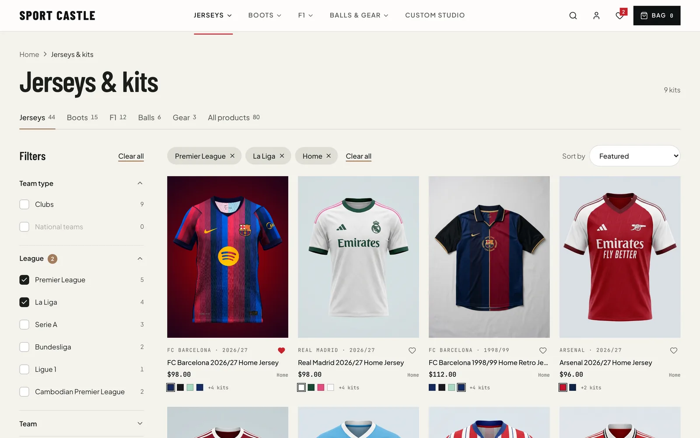
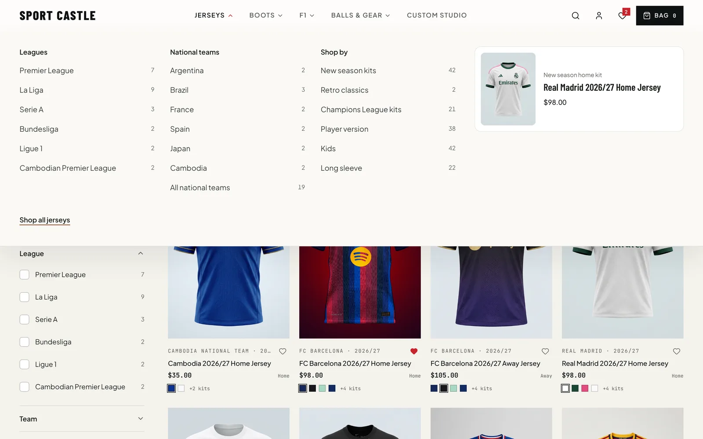
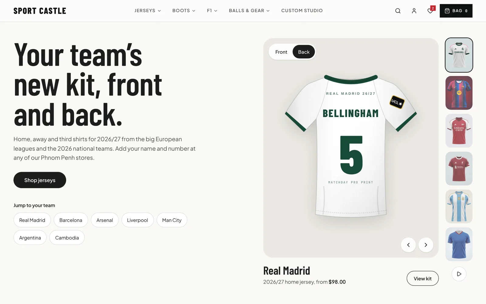
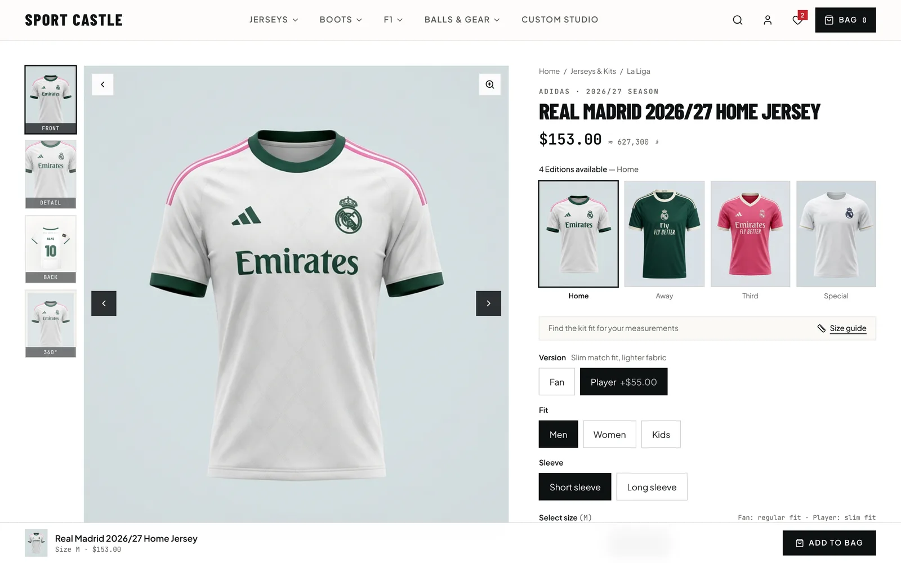
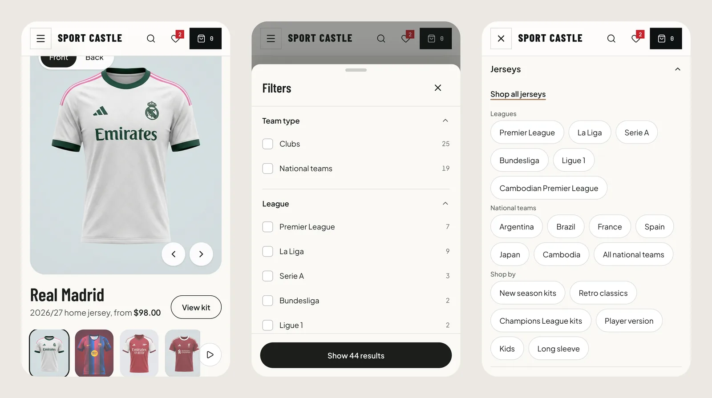

# Sport Castle

A football and F1 kit store for Phnom Penh, built as a portfolio project.
Shoppers can see every jersey **front and back**, filter 80 products by team, league, season and kit type, pick a Fan or Player version, and share any filtered view as a link.

[](https://github.com/danishsary8/sport-heaven/actions/workflows/ci.yml)

**Live demo:** _add your deployed link here_ · **Code:** this repository

> Portfolio demo, not a real store. Product images and names belong to their brands and clubs.



---

## What it does

| | |
|---|---|
| **Front and back of every kit** | The home page shows one jersey at a time and turns it to show the back. Product cards flip on hover (desktop) or swipe (phone). |
| **Filters that make sense for football** | Team type, league, team, season, kit type (Home / Away / Third), version, fit, sleeve, size, brand and price. Each option shows how many products it would return. |
| **Shareable filtered views** | Every filter, search and sort lives in the URL, e.g. `#/collections/jerseys-kits?league=la-liga&kit=home`. Back and forward work; links open the same results. |
| **Fan or Player version** | Pick version, fit and sleeve on the product page. The Player version costs more, and the choice follows the item into the bag, checkout and the order message. |
| **Real product facts** | Kit supplier, front sponsor and fabric per version (e.g. Adidas AEROREADY vs HEAT.RDY) come from one data file, each with a confidence level. Unconfirmed facts are hidden from shoppers. |
| **Photo pipeline** | `npm run images` turns downloaded photos into WebP and links them to products automatically. |
| **Built for phones** | Bottom-sheet filters (the phone's Back button closes them), grouped mobile menu, 44px touch targets. |

## Screenshots

| Shop with filters | Menu built from the same filters |
|---|---|
|  |  |

| Back of the kit | Product page with version picker |
|---|---|
|  |  |

**On a phone:** home, filter sheet, menu



## Tech stack

- **Frontend:** React 19, TypeScript, Vite 8, Tailwind CSS 4, Motion (animation), lucide-react (icons)
- **Backend (included, not needed for the demo):** Express, Zod validation, Drizzle ORM with PostgreSQL (10 tables), Firebase Auth, rate limiting, HMAC-verified payment webhooks (ABA KHQR, Stripe), Telegram and email order notifications, a system-health dashboard with PDF reports
- **Tooling:** sharp (image pipeline), Node's built-in test runner with tsx, Playwright for screenshots, GitHub Actions

## How it is built

**One filter engine for the shop, the menus and the URL.**
`src/lib/shop-filters.ts` defines every facet once: how to read it from a product, how to label it and how to sort it. The shop sidebar, the mobile sheet, the active-filter chips and the navigation menus all use the same definitions, and a test checks that every menu link returns results. Counts follow the usual store rule: options inside a facet combine with OR, different facets with AND, and each count ignores its own facet so you can see what another choice would add.

**The URL is the single source of truth.**
There is no separate filter state to keep in sync. The page reads filters from the address, and changing a filter writes a new address. That is what makes links shareable and the Back button predictable.

**Product facts with honesty built in.**
`src/data/kit-details.ts` stores each fact as `confirmed`, `likely` or `unverified`. Descriptions and the specification table are generated from it, and anything unverified is left out. `npm run images:docs` writes a review list of what still needs checking.

**Works without a server.**
The app asks the API for the catalog and falls back to built-in data when there is none, so the whole store runs as a static site.

**Performance and accessibility.**
- Only the home page loads up front; every other page loads on first visit (main bundle 2.3 MB → 758 kB).
- Keyboard support on the carousel, filters and menus; visible focus rings.
- Autoplay pauses on hover and focus and stops once you take control. With "reduce motion" switched on, nothing moves on its own.

## Run it locally

Needs Node 20 or newer.

```bash
npm install
npm run dev
```

Open http://localhost:3000.

| Command | What it does |
|---|---|
| `npm run dev` | Start the app with hot reload |
| `npm test` | Run the unit tests (filters, product facts, cart and orders) |
| `npm run lint` | Type-check the whole project |
| `npm run build` | Production build into `dist/` |
| `npm run images` | Convert photos in `public/products/<slug>/` to WebP and link them |
| `npm run images:docs` | Regenerate the photo checklist and product-details review |

## Deploy (free)

The production build is a static site, so any static host works. On **Vercel**: import the repository, keep the Vite preset, build command `npm run build`, output folder `dist`. Netlify and Cloudflare Pages use the same two settings. No environment variables are needed for the demo.

## Project structure

```
src/
  components/   UI: layout (navbar, menus), product (cards, hero), shop (filters)
  data/         catalog, kit facts, navigation and hero content
  lib/          shop-filters (facet engine), product-attributes (versions, fits, photos)
  pages/        one file per page; all but Home load on demand
  context/      store state: cart, wishlist, routing
backend/        Express API, payment webhooks, notifications, health dashboard
scripts/        image pipeline and docs generators
docs/           photo checklist, product review, screenshots
```

## Credits

Designed and built by **Sary Danish** as a portfolio project.
Fonts: Barlow Condensed and Plus Jakarta Sans (Google Fonts). Product images and names belong to their respective brands and clubs and are used here for a non-commercial demo only.
