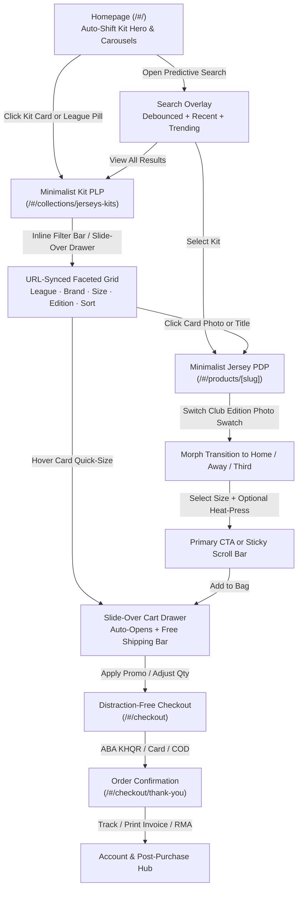

# 01 — Sitemap, Route Topology & User Flows
**Audit Source:** Live Playwright inspection of `https://zandoshops.com/` (Desktop `1440×900` & Mobile `390×844`)  
**Target Domain Application:** **SPORT CASTLE — Minimalist Kit Atelier** (applied exclusively to Football Jerseys, National Kits & Formula 1 Teamwear inside our 35-route storefront).

---

## 1. Reverse-Engineered Zando Navigation & Route Findings

During live desktop and mobile browser inspection of `zandoshops.com`, the following behavioral mechanics were observed and abstracted (zero Zando branding, copy, or assets retained):

1. **Top Utility Strip & Two-Tier Navigation Shell**:
   - A slim (`30–32px`) free-delivery announcement bar anchors the top viewport edge.
   - Clean high-contrast navigation splits segment tabs (`UCL 26/27`, `Top 5 Leagues`, `Cambodia`, `F1 Paddock`, `All Kits` in our kit domain) from centered/left brand wordmark and right utility icons (Predictive Search, Account, Wishlist Counter, Bag Counter).
   - Desktop hover mega-menu exposes sub-collections alongside editorial visual promos; mobile collapses into a full-height accordion drawer with `Escape` and backdrop dismissal.
2. **Hero & Horizontal Rail Auto-Shift Mechanics**:
   - Full-width campaign hero carousel with pagination indicator bars, directional arrows, touch swipe, and pause-on-hover auto-advance.
   - Directly beneath: a clean horizontal Partner Brand strip followed by horizontally scrollable, arrow-controlled product carousels with scroll-snap alignment.
3. **PLP Horizontal Filter Bar + Drawer Architecture**:
   - Instead of bulky always-open left sidebars on apparel/kit pages, Zando uses a clean **single-row top filter toolbar**: Collection Title + Item Count on the left, `[Filter]` slide-over drawer trigger + inline quick-filter dropdowns (`League`, `Brand`, `Size`, `Price`, `Edition`) in the center, and `Sort by` + grid density toggles on the right.
   - Portrait `3:4` garment cards maximize jersey visibility, pairing brand + wishlist heart on one row, single-line title, sale/original monospace pricing, and inline square colorway swatches beneath.
4. **PDP Split Editorial Gallery + Photo-Swatch Variant Matrix**:
   - Left `60%`: Vertical thumbnail rail on the far left paired with a large interactive primary gallery stage (`<` / `>` arrows + lightbox zoom).
   - Right `40%`: Breadcrumb, Brand, Title, Pricing, **Visual Photo-Thumbnail Edition Switcher** (e.g., Club `Home` / `Away` / `Third` kit photos side-by-side with active obsidian outline), inline `"Find your fit · Size guide"` bar, clean rectangular Size Selector (`S M L XL XXL` with strikethrough for unavailable sizes), Full-Width `Add to Bag` + square `Wishlist` button side-by-side, 2-column Shipping/Returns trust strip, and minimalist expandable accordions.

---

## 2. Canonical Route Topology (Kit-Focused Journey + 35-Page Storefront)

| Route Pattern | Surface Role | URL Query / Hash Contracts |
| :--- | :--- | :--- |
| `/#/` | Editorial Kit Homepage | Auto-shift Hero Showcase + Auto-shift UCL & Club Kit Carousels |
| `/#/collections/jerseys-kits` | Minimalist Kit PLP | `?league=...&brand=...&size=...&edition=...&sort=...&maxPrice=...` |
| `/#/collections/ucl-2026-27` | 2026/27 UCL Drop PLP | Pre-filtered `uclOnly=true`, Kit Toolbar + Portrait `3:4` Grid |
| `/#/collections/f1-motorsport` | 2026 F1 Paddock Kits PLP | Pre-filtered `category=f1`, Kit Toolbar + Portrait `3:4` Grid |
| `/#/brands/[slug]` | Brand Kit Boutique | `/brands/nike`, `/brands/adidas`, `/brands/puma`, `/brands/varaman` |
| `/#/search?q=[term]` | Predictive Search Results | Spell-tolerant fuzzy match (`barcalona` → `Barcelona`), active facets |
| `/#/products/[slug]` | Minimalist Jersey PDP | Vertical thumbnail rail, visual edition photo swatches, live heat-press customizer, sticky Add-to-Bag bar |
| `/#/cart` & Slide-Over Drawer | Cart & Threshold Progress | Free Phnom Penh Express ($50 threshold), promo codes (`CASTLE10`, `KIT15`), KHR conversion |
| `/#/checkout` → `/#/checkout/thank-you` | Distraction-Free Checkout | Guest toggle, ABA KHQR / Card / COD, itemized receipt + order tracking ID |
| `/#/account/*`, `/#/returns`, `/#/pages/*`, `/#/policies/*` | Account, Post-Purchase & Legal | Complete 35-route production e-commerce ecosystem |

---

## 3. Core Shopper Flow Diagram (Mermaid)

